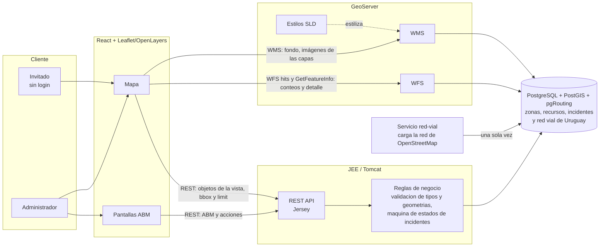

# UrbanSafe: gestión geográfica de emergencias urbanas con PostGIS, GeoServer y pgRouting

*Borrador colaborativo. Estructura tomada de `template-paper-2013.doc` del curso —
antes de entregar, pasar este contenido al formato/plantilla que pida la cátedra.*

Autores: Nahuel Leguisamon nanuleguisamoncabrera@gmail.com · Carlos Barrios charlynbc1991@gmail.com · Facundo Cabrera facufa12@gmail.com · Bruno Salvatore brunosalvatore2604@gmail.com · Gonzalo Soba gonzalosoba99@gmail.com

## Resumen

Las empresas que atienden emergencias urbanas necesitan ver sobre un mapa dónde ocurren los incidentes, qué recursos
(ambulancias, bomberos, patrullas) tienen cerca y en cuánto tiempo pueden llegar. Este trabajo presenta **UrbanSafe**, un
sistema web de gestión geográfica de emergencias construido con PostgreSQL/PostGIS, GeoServer, un backend JEE (Jersey) sobre
Tomcat y un cliente React con Leaflet. El sistema ofrece el alta, la modificación y la baja de zonas operativas, recursos e
incidentes, ocho consultas geográficas, una vista pública para invitados, la búsqueda por dirección o cruce de calles y el
cálculo del tiempo de llegada por las calles, con sus sentidos de circulación, en todo Uruguay. El resultado es un sistema que
se levanta con un solo comando, se defiende sobre Salto y atiende todo el país con miles de objetos, apoyándose en la
carga a demanda y en una red vial de OpenStreetMap procesada dentro de la propia base.

**Palabras clave:** GIS, PostGIS, GeoServer, WMS, WFS, SLD, pgRouting, OpenStreetMap, sistema de gestión de emergencias urbanas.

## Introducción

Cada vez hay más aplicaciones que usan información geográfica y eso trae estándares abiertos (WMS, WFS, SLD) y productos que
los implementan. Una empresa de emergencias es un caso natural: cada incidente, cada recurso y cada zona de responsabilidad
tiene una ubicación, y las decisiones (a quién enviar, cuánto tarda en llegar, qué zona está más cargada) son preguntas
espaciales.

El desafío del proyecto fue construir una aplicación geográfica completa con la plataforma que pide el curso (JEE,
PostGIS, GeoServer, un cliente web de mapas) para un administrador, que gestiona los datos, y un invitado, que solo consulta.
Los requisitos agregaron tres exigencias que condicionaron el diseño: que el sistema atienda **todo el país**, aunque la
defensa se haga en Salto; que aguante **miles de objetos** sin cargarlos todos en el navegador; y que los caminos entre un
recurso y un incidente **respeten las calles** y sus sentidos de circulación.

El trabajo se hizo en el marco de la edición 2026 de la asignatura Taller de Sistemas de Información Geográficos Empresariales
(Tecnólogo Informático, Facultad de Ingeniería, UdelaR). Empezó con otra letra (GeoTravel, recorridos turísticos) y se
reestructuró a UrbanSafe a mitad de semestre, manteniendo la arquitectura.

El resto del documento se organiza de la siguiente manera. La sección 2 presenta los conceptos necesarios. La sección 3
describe el problema planteado. En las secciones 4 y 5 se presentan la solución y su arquitectura. La sección 6 detalla la
implementación, los productos usados y los problemas encontrados. Por último, las secciones 7 a 9 evalúan la solución,
cuentan cómo se desarrolló el proyecto y presentan las conclusiones.

## Marco conceptual

**Servicios web geográficos.** WMS (*Web Map Service*) entrega mapas ya dibujados como imágenes; WFS (*Web Feature Service*)
entrega los objetos con su geometría y sus atributos; SLD (*Styled Layer Descriptor*) define cómo se dibuja cada capa. En
este trabajo GeoServer los publica a partir de las tablas de la base.

**Bases de datos geográficas.** PostGIS agrega a PostgreSQL los tipos geométricos, los índices espaciales (GiST) y las
funciones de análisis (`ST_Intersects`, `ST_DWithin`, `ST_Transform`...). Cada geometría tiene un sistema de referencia (SRID):
aquí se guarda en EPSG:32721 (UTM 21S, en metros, que permite medir distancias) y se publica en EPSG:4326 (grados), que es lo
que usan Leaflet y GeoJSON.

**Ruteo sobre una red.** Una red de calles se modela como un grafo: los vértices son las esquinas y los arcos son los tramos
de calle entre dos esquinas, con un sentido de circulación y un costo (por ejemplo, el tiempo en recorrerlos). pgRouting
agrega a PostGIS el algoritmo de Dijkstra para encontrar el camino de menor costo entre dos vértices.

**Geocodificación.** Convertir una dirección ("Uruguay 1000") o un cruce de calles en una coordenada. Se puede hacer con una
tabla propia de números de puerta o con un servicio externo, como el de la Infraestructura de Datos Espaciales de Uruguay (IDE).

**OpenStreetMap.** Mapa libre y colaborativo (licencia ODbL) que trae, para cada calle, su nombre, su tipo, si es de sentido
único (`oneway`) y, en parte, su velocidad máxima (`maxspeed`). Geofabrik publica extractos por país.

## Descripción del problema

El sistema administra tres entidades, cada una con su ubicación: las **zonas operativas** (polígonos con nombre, prioridad,
responsable y observaciones), los **recursos** de emergencia (puntos: ambulancias, camiones de bomberos, patrullas, centros de
atención, otros, con un estado operativo) y los **incidentes** (accidentes de tránsito, incendios, cortes de servicios,
inundaciones y otros, con título, prioridad, tipo, estado, fecha y hora, equipo responsable y una ubicación que puede ser un
punto, una línea o un polígono). Un incidente pasa por los estados Registrado, En atención, Derivado, Resuelto y Cancelado, y se
guarda el historial de cada cambio. Las zonas pueden superponerse (definición del tutor), de modo que un punto puede pertenecer
a más de una.

Hay dos roles. El **administrador** da de alta, modifica y elimina las tres entidades, hace avanzar los incidentes, ve el
historial y los reportes. El **invitado** solo consulta incidentes (filtrados por tipo, estado, prioridad y fecha), recursos
disponibles y zonas.

Las consultas geográficas pedidas son ocho: incidentes por zona, zonas con más incidentes en un período, recursos cercanos a
un incidente, incidente más cercano a una dirección o cruce de calles, zona de una dirección, recursos por zona, incidentes por
recurso y concentración de incidentes. Como opcionales, el control de superposición de zonas, el tiempo estimado de llegada,
el recurso más cercano a un incidente y el mapa de calor. La aplicación debe ser responsive.

Por último, se debe implementar un prototipo sobre una base geográfica con datos de prueba, con un servidor de mapas
(GeoServer) y un cliente web. En el monitoreo del 18 de octubre se agregaron condiciones: la defensa es en Salto, pero el
sistema debe admitir todo el país y aguantar miles de objetos, y se necesita un login básico para separar las vistas.

## Solución planteada

La solución separa las responsabilidades en cuatro capas. **PostgreSQL con PostGIS** guarda los datos y hace todo el cálculo
espacial (consultas, conversión de coordenadas y ruteo). **GeoServer** publica las tablas como capas WMS y WFS con estilos
SLD. Un **backend JEE** (Jersey/JAX-RS, sobre Tomcat) expone una API REST con las reglas de negocio y valida cada dato. Un
**cliente React con Leaflet** dibuja el mapa, ofrece los ABM al administrador y las consultas al invitado.

Dos decisiones recorren todo el diseño. La primera es **no mover datos de más**: el navegador pide solo lo que se ve (carga a
demanda con rectángulo y límite) y, con el mapa alejado, GeoServer dibuja los objetos como imagen. La segunda es **dejar el
cálculo dentro de la base**: las consultas espaciales y el ruteo se resuelven en SQL con PostGIS y pgRouting, sobre una red
vial de OpenStreetMap de todo Uruguay que se carga una vez, de modo que las rutas se calculan sin internet.

Todo se levanta con `docker compose up -d --build`: la base con sus migraciones (Flyway), los datos de prueba, la red vial, la
configuración de GeoServer y el backend con su `.war`.

*Figura 1. Arquitectura de UrbanSafe (fuente: `docs/diagramas/arquitectura.md`; para el documento final, exportarla como imagen).*

## Arquitectura del sistema

| Capa | Tecnología | Qué hace |
|---|---|---|
| Datos | PostgreSQL + PostGIS + pgRouting (`db/migrations`, Flyway) | Guarda zonas, recursos, incidentes, historial, las calles, las puertas y la red vial; hace consultas y rutas |
| Publicación de mapas | GeoServer (WMS, WFS, SLD en `geoserver/styles`) | Dibuja las capas y entrega objetos y detalle por clic |
| API | JEE / Jersey sobre Tomcat (`backend/`) | Reglas de negocio, validaciones, autenticación, consultas y cálculo de rutas |
| Interfaz | React + Leaflet (`frontend/`) | Mapa público, ABM del administrador, consultas y tiempo de llegada |

Los pedidos del cliente se reparten según lo que necesitan. El **fondo y las imágenes de las capas** salen de GeoServer por
WMS. Los **conteos y el detalle** de lo que se toca en el mapa público salen de GeoServer por WFS (`resultType=hits` con un
filtro CQL por el rectángulo visible) y GetFeatureInfo. Los **objetos de la vista actual** (con su geometría, para dibujarlos y
editarlos) y todas las acciones salen del backend por REST, con `bbox` y `limit`. El backend consulta la base por JDBC; no pasa
por GeoServer. Las pantallas de gestión dibujan además un fondo de referencia, sin clics, con las calles de la red de rutas por jerarquía (a lo lejos solo las rutas y avenidas; al acercarse, las de barrio con su nombre) y los nombres de ciudades, pueblos y barrios (`lugar_osm`). Como no cambia, se pide por el caché de teselas de GeoServer (GeoWebCache) y no se dibuja de nuevo en cada pedido.

Un filtro de autenticación (`AuthFilter`) niega todo por defecto y deja públicas solo las lecturas que ve el invitado y el
inicio de sesión del administrador.

Los servicios del `docker-compose` son: `db` (PostGIS con pgRouting), `flyway` (migraciones), `seed` (datos de prueba),
`red-vial` (carga la red de OpenStreetMap), `geoserver`, `geoserver-init` (crea el workspace, las capas y los estilos) y
`backend`.

## Implementación

### Zonas operativas y recursos de emergencia (P3)

Este módulo permite al administrador crear, editar y eliminar las **zonas operativas** (polígonos con un nivel de
prioridad de 1 a 5) y los **recursos de emergencia** (puntos con un tipo y un estado operativo). El servicio REST está
en `ZonaResource` y `RecursoResource` (Jersey, JDBC y PostGIS) y la interfaz en React con Leaflet.

**Sistemas de coordenadas.** La base guarda las geometrías en EPSG:32721 (UTM 21S, en metros), que cubre Salto y casi
todo el país y permite medir distancias en metros; Leaflet y GeoJSON trabajan en EPSG:4326 (grados). La conversión se hace
siempre dentro de la consulta SQL, con las capacidades de la base: al guardar,
`ST_Transform(ST_SetSRID(ST_GeomFromGeoJSON(?), 4326), 32721)`; al leer, `ST_AsGeoJSON(ST_Transform(geom, 4326))`. Un
detalle que da errores sutiles es el orden de las coordenadas: GeoJSON usa `[lon, lat]` y Leaflet `[lat, lon]`, por lo que
en el módulo de recursos la conversión está aislada en dos funciones.

**Validaciones.** El backend rechaza con `400` una zona sin nombre, con prioridad fuera de 1 a 5 o con una geometría que no
sea un polígono válido (`ST_IsValid` y `GeometryType = 'POLYGON'`, lo que descarta también polígonos que se cruzan a sí
mismos y GeoJSON mal formado). Un recurso solo se acepta si su tipo está en una lista cerrada (ambulancia, bomberos,
patrulla, centro de atención u otro, normalizado a minúsculas), si su estado operativo es válido y si su ubicación es un
punto. Las zonas **pueden superponerse** (definición del tutor), por lo que un punto, un recurso o un incidente puede
pertenecer a más de una zona y las consultas por punto devuelven todas.

**Dibujo y edición en el mapa.** Las zonas se dibujan y se modifican arrastrando sus vértices (`leaflet-draw`); al guardar
se lee la forma directamente de la capa del mapa, para que valga lo que el usuario está viendo aunque no haya confirmado el
cambio en la barra de dibujo. Los recursos se ubican con un clic. Cada tipo de recurso tiene su propio ícono (la **forma** es
el tipo y el **color** es el estado operativo) y son los mismos archivos SVG que usa GeoServer, para que todos los mapas se
vean igual (ver `docs/ICONOS.md`).

**Carga a demanda.** Con miles de zonas y recursos no es viable que el navegador reciba todos los objetos. Los listados
aceptan `?bbox=oeste,sur,este,norte&limit=N` y devuelven `{items, total, truncado}`: la consulta filtra con
`geom && ST_Transform(ST_MakeEnvelope(...), 32721)`, que usa el índice espacial GiST, calcula el total real con
`COUNT(*) OVER ()` antes de aplicar el límite (500 por defecto, 2000 como máximo) y recorta el rectángulo a la extensión de
Uruguay antes de transformarlo. En el frontend, un componente compartido pide solo lo visible, espera 300 ms tras mover el
mapa, cancela el pedido anterior y reemplaza la capa en lugar de acumularla; con el mapa alejado no pide nada y deja que
GeoServer dibuje todos los objetos como imagen (WMS). Si hay más objetos que el límite, la pantalla avisa ("Mostrando 500
de 3000"). Se probó con una carga masiva de 700 zonas y 3000 recursos en Salto (`db/pruebas/carga-masiva.sql`). Además se midió con 100.000 incidentes, 30.000 recursos y 5.000 zonas sintéticos (cargados y borrados después): los listados por rectángulo responden en 0,2 a 90 ms y los dibujos de GeoServer en menos de 130 ms. Esa revisión dejó tres cambios: los listados sin rectángulo también tienen tope (2.000, con la cantidad real en el encabezado `X-Total-Count`), el fondo de calles y barrios se sirve desde el caché de teselas de GeoServer (GeoWebCache) y las consultas a la base tienen un tiempo máximo de 15 s.

**Pruebas.** Hay pruebas unitarias del rectángulo y del límite (`BboxTest`) y pruebas de integración contra PostGIS
(`ZonasRecursosIntegrationTest`, se ejecutan con `URBANSAFE_INTEGRATION_TESTS=true`): comprueban que una zona idéntica a otra
se acepta, que se rechazan los polígonos inválidos, la prioridad fuera de rango y los tipos de recurso no permitidos, y que lo
creado aparece en el listado de su rectángulo y no en uno lejano.

**Datos de prueba realistas.** Las zonas y los recursos de los datos de prueba son reales, no figuras sorteadas en un
rectángulo. Las **zonas** son las seccionales policiales con sus límites oficiales (16 en Salto y 25 en Montevideo; fuente:
Ministerio del Interior y UNASEV), con la prioridad calculada a partir de la densidad de población de cada una, y encima,
superpuestos, los 8 municipios de Montevideo (Intendencia de Montevideo) y las localidades de Salto y Termas del Daymán
(OpenStreetMap). Los **recursos** son 21 en Salto y 225 en Montevideo: hospitales, mutualistas, policlínicas, destacamentos de
bomberos, comisarías y bases de emergencia móvil, en sus coordenadas reales (lista de servicios de salud de la Intendencia de
Montevideo y OpenStreetMap). OpenStreetMap trae pocos servicios de Salto, así que el resto de los recursos de ahí (unidades
móviles en recorrida y ambulancias del interior) son simulados y están marcados como tales. El conjunto trae 198 incidentes (114 en Salto y 83 en Montevideo) y 77 unidades móviles simuladas, que suman 88 patrullas y 37 ambulancias en total. Los incidentes de la ciudad van
sobre las calles, más donde hay más calles, siempre del lado de Salto (la tabla de calles también trae Concordia, del otro lado del río). Esto no es solo estético: un recurso o un
incidente en el río no tiene camino, y el cálculo de rutas (distancia y tiempo de llegada) necesita que ambos extremos
estén en la red vial.

**Limitaciones.** Al eliminar un recurso se quita de las asignaciones de incidentes (borrado en cascada); la pantalla avisa
cuántas son antes de confirmar, pero no se conserva ese historial. Las listas no se pueden filtrar por tipo, estado o
prioridad, y los polígonos no se simplifican según el zoom.

### Consultas geográficas y mapa público (P5)

Las ocho consultas de la letra están en `ConsultaResource` y en la pantalla Consultas, numeradas como en el enunciado. Todas se
resuelven en SQL con PostGIS. Las que cruzan un incidente con una zona usan `ST_Intersects` y no `ST_Contains`, porque un
incidente puede ser una línea (una calle cortada) o un polígono (un área inundada) que cruza el borde de una zona sin estar
completamente adentro. Las zonas que concentran más incidentes en un período (consultas 2 y 8) se calculan con un conteo
espacial agrupado por zona. Como las zonas pueden superponerse, una consulta por punto devuelve todas las zonas que lo
contienen.

**Carga a demanda.** Ninguna consulta carga todos los objetos al abrirse. Cada una devuelve la geometría de lo que encontró y,
las que pueden dar muchas filas, aceptan `limit` y responden `{items, total, truncado}`. El fondo lo dibuja GeoServer (WMS) y el
mapa se encuadra solo sobre el resultado. Los desplegables para elegir una zona, un recurso o un incidente son un buscador por
texto (`/consultas/buscar`) que busca en todo el sistema y no obliga a cargar listas completas. Se probó con una carga masiva de
700 zonas y 3.000 recursos.

**Vista del invitado.** El mapa público muestra zonas, recursos, incidentes y capas de referencia (calles y la red de rutas) y los nombres de barrios.
Los conteos de cada capa son los de **lo que se ve**: se piden a GeoServer por WFS con `resultType=hits` y un filtro CQL
`BBOX(geom, ...)` con el rectángulo visible, y se actualizan al mover el mapa. Al hacer clic se pide el detalle con
GetFeatureInfo y se resalta el objeto. Con el mapa alejado, los objetos superpuestos se agrupan con un número: GeoServer usa la
transformación `PointStacker` (celdas de 64 px) y el navegador, `leaflet.markercluster`; del zoom 15 en adelante se ven los
íconos. Cada tipo de incidente tiene su ícono y se muestra una leyenda compartida con las pantallas de consultas. El invitado ve
las consultas 1 a 7; el reporte con filtros es del administrador.

### Direcciones y cruces de calles (P5)

Las consultas 4 y 5 parten de una dirección o de un cruce de calles. `/consultas/geocodificar` busca en dos lugares, en este orden:

1. **Tabla propia `acceso`** (31.007 números de puerta de Salto). Los nombres se normalizan con una función SQL
   (`normalizar_calle`: sin tildes, mayúsculas ni puntuación; `Av.` pasa a AVENIDA, `Gral` a GENERAL) y se tolera el error de
   tipeo con trigramas (`pg_trgm`). No necesita internet.
2. **IDE de Uruguay** (`BusquedaDireccion`), que tiene los números de todo el país. El buscador arranca en "Todo el país"
   (`departamento=todo`): la IDE busca en los 19 departamentos, se toma la mejor coincidencia (la del portal exacto) y las demás
   se ofrecen como alternativas. También acepta departamento y localidad concretos.

El **cruce de dos calles** (`/consultas/interseccion`) se calcula sin internet y para todo el país sobre la red vial de
OpenStreetMap: un cruce es un vértice del grafo al que llegan un tramo de cada calle. Como una calle se repite en muchas
localidades ("Colonia" son 60 vías en el país), se agrupan los cruces cercanos (`ST_ClusterDBSCAN` a 80 m) y se devuelven hasta
10, ordenados por cercanía a la región, cada uno con la ciudad, pueblo o barrio más próximo (tabla `lugar_osm`, 1.353 lugares del
mismo extracto). Por ejemplo, "Colonia" y "Convención" dan un cruce en Montevideo y otro en Pinares de Solymar. El
autocompletado de nombres de calle (`/consultas/calles`) sale de la misma red.

### Red vial y rutas con pgRouting (P5)

El tiempo de llegada de un recurso a un incidente se calcula con pgRouting sobre una red de OpenStreetMap de **todo Uruguay**.

**Construcción de la red.** El servicio `red-vial` baja una sola vez el extracto de Uruguay de Geofabrik (56 MB) y lo procesa con
`pyosmium`: parte cada calle en tramos de esquina a esquina (los vértices son los nodos compartidos por más de una calle) y
deja una tabla de vértices (`red_vial_vertice`) y otra de arcos (`red_vial_arco`, 216.179 arcos). Cada arco guarda su sentido
(doble, directo o inverso, a partir de `oneway`, las rotondas y las autopistas), su velocidad (`maxspeed` o, si falta, una por
tipo de vía) y su costo en segundos: tiempo de recorrerlo más 3 s por cada esquina. Se calcula además la componente conexa de
cada arco (`pgr_connectedComponents`) para saber qué tramos están aislados de la red principal. La misma carga deja la tabla
`lugar_osm` y las 60.261 vías con nombre que usa la capa "Calles" del mapa.

**Cálculo de la ruta.** La función SQL `p2_calcular_ruta(lon_o, lat_o, lon_d, lat_d)` recibe dos puntos y devuelve la
distancia, la duración, la geometría de la ruta, cuánto se movió cada extremo para quedar sobre una calle y la lista de calles
recorridas. Primero **ajusta cada extremo a la calle más cercana** (hasta 500 m), en el punto exacto de la calle, partiendo
virtualmente el arco. Después corre `pgr_dijkstra` con un costo negativo en el sentido prohibido de cada arco, lo que
respeta las **calles de mano única**. Para no cargar el grafo entero, el algoritmo trabaja sobre los arcos de un rectángulo
alrededor de los dos puntos y, si no encuentra camino, lo agranda dos veces más. La ruta incluye los tramos de calle cortados
al comienzo y al final, de modo que la línea toca los dos marcadores.

**Un solo criterio.** Se calcula una sola ruta, la de **menor tiempo**. Se descartaron "más rápida" y "más corta" porque el
caso de uso pide un camino por incidente.

**Integración.** `MotorPgRouting` (backend) llama a la función; `RutaService` aplica un plazo y devuelve un error claro si la
base no responde, y `GET /eta/disponible` informa si el motor está listo. La consulta 3 (`analisis-vial`) busca los recursos
dentro de un radio del incidente, calcula la ruta de cada uno por las calles y marca el **recurso más rápido**. En la pantalla
se ve la ruta en el mapa, su distancia y duración, y una lista con las **calles del recorrido**. La red también se publica como
capa "Red de rutas", con flechas en las calles de mano única (un `GraphicStroke` en SLD).

**Resultados medidos.** En la base de prueba, una ruta de 4,7 km dentro de Salto tarda unos 50 ms; una de 6,1 km en Montevideo,
unos 300 ms; y una de 489 km entre Salto y Montevideo, 1,1 s. Con la red de todo el país la tabla de arcos ocupa unos 254 MB.

**Pruebas.** `PgRoutingIntegrationTest` (10 pruebas, contra una base real con la red cargada) verifica, entre otras cosas, que
la ruta salga y llegue a los puntos pedidos, que informe las calles del recorrido, que funcione en Montevideo (la red cubre todo el
país), que un punto fuera de cobertura dé "sin ruta", que dos puntos iguales den una ruta nula y que el plazo agotado se traduzca
en un error claro.
`BusquedaEnTodoElPaisTest` cubre las direcciones y los cruces. En total, la suite del backend tiene 118 pruebas; 31 de integración
se activan con una variable de entorno.

### Autenticación y vistas por rol (P5)

El administrador inicia sesión con un usuario y una clave definidos por variables de entorno (`ADMIN_USUARIO`, `ADMIN_CLAVE`).
`AuthFilter` niega por defecto: solo son públicos el estado del servicio, el inicio de sesión, las
fotos, las lecturas (`GET`) de zonas, recursos e incidentes, las consultas (menos el reporte) y `GET /eta/disponible`. Todo lo que
escribe datos exige sesión. En el frontend, el invitado ve el mapa público y las consultas y el administrador además los ABM.

### Incidentes con punto, línea o polígono (P5)

La ubicación de un incidente puede ser un punto, una línea (una calle cortada) o un polígono (un área inundada): la columna
pasó a `Geometry` (migración V4) y el backend valida la forma (`ST_IsValid` y tipo permitido). El componente compartido
`EditorGeometria` dibuja y edita las tres formas con `leaflet-draw` y una barra en español; mantiene estables las opciones de
la barra, porque `react-leaflet-draw` la rehace en cada render y cancela el trazo en curso si cambian. La máquina de estados
permite Registrado → En atención / Derivado / Cancelado, En atención → Resuelto / Derivado / Cancelado y Derivado → En atención /
Cancelado; Resuelto y Cancelado son terminales. Es un supuesto a confirmar con el tutor, y cada cambio queda en
`historial_estado` con su fecha y usuario.

### Mapa de calor de incidentes (opcional)

El mapa público tiene una capa "Mapa de calor de incidentes", apagada por defecto, que muestra dónde se concentran los
incidentes, de azul (pocos) a rojo (muchos). La calcula **GeoServer** con la transformación de renderizado `vec:Heatmap`
(`geoserver/styles/incidentes_calor.sld`): cada incidente suma una "campana" de 45 píxeles y donde se juntan varios la intensidad
sube. Es la misma capa `geotravel:incidente` con otro estilo, así que no se traen los incidentes al navegador y el cálculo se
hace donde están los datos. Un incidente que es una línea o un polígono entra por su centroide. La capa respeta el mismo
`CQL_FILTER` que los demás pedidos, de modo que el calor sigue los filtros de Incidentes (tipo, estado, prioridad y fechas): al elegir
"Incendio", queda el calor de los incendios.

La intensidad es **relativa a lo que se ve**: GeoServer escala cada imagen según su propio máximo. Por eso el mapa de calor no se
pide en teselas de 256 px, como las demás capas, sino como **una sola imagen** del área visible (`CapaCalor.jsx`), que se vuelve a
pedir cuando el mapa deja de moverse; con teselas, un pueblo con tres incidentes quedaba tan rojo como la ciudad con cuarenta.

### Productos y herramientas

| Producto | Puntos fuertes | Puntos débiles | Evaluación general |
|---|---|---|---|
| PostGIS | Tipos, índices GiST y funciones espaciales dentro de SQL; permite resolver consultas, conversión de coordenadas y validación de formas en la base; muy buena documentación | Hay que cuidar los sistemas de referencia (EPSG:32721 en la base, 4326 en la API) y el orden de las coordenadas | Imprescindible; todo el cálculo espacial se hace acá |
| pgRouting | Dijkstra dentro de la base, con costo por sentido (negativo = prohibido) y sin servicio aparte; se combina con el resto de PostGIS | Hay que construir y mantener el grafo (arcos cortados en esquinas, componentes conexas); solo calcula sobre lo que se le carga | Adecuado: reemplazó a OSRM y cubre todo el país |
| OSRM (evaluado y retirado) | Muy rápido, trae sentidos y velocidades | Servicio aparte, un preprocesamiento por región (solo se había hecho Salto), no se integra con las consultas de la base | Descartado a favor de pgRouting |
| GeoServer | Publica tablas como WMS/WFS con estilos SLD sin programar; agrupa puntos (`PointStacker`) y dibuja flechas en las calles de mano única; filtros CQL | Configuración extensa (se automatizó con `geoserver-init.sh`); guarda la extensión de cada capa al publicarla y se desactualiza si cambia la tabla; mantiene conexiones que se cortan si la base se recrea | Bueno; reduce mucho el trabajo del cliente |
| Jersey (JAX-RS) sobre Tomcat | Estándar de JEE, simple para una API REST, fácil de probar y de proteger con un filtro | Más código repetitivo (JDBC a mano) que un framework con ORM | Cumple lo pedido por el curso |
| React + Leaflet | Mapa liviano, muy buen ecosistema (`leaflet-draw`, `markercluster`), responsive | Los plugins de dibujo tienen trampas (`react-leaflet-draw` rehace la barra en cada render); hay que cancelar pedidos al mover el mapa | Bueno para esta escala; con GeoServer dibujando lo alejado alcanza |
| OpenStreetMap + Geofabrik | Gratis, de todo el país, con sentidos, velocidades y nombres | Calidad despareja (velocidades faltantes, nombres que no coinciden con otras fuentes); el extracto se actualiza a mano | Mejor fuente disponible para rutear |
| IDE Uruguay (BusquedaDireccion) | Números de puerta de todo el país | Requiere internet y no ofrece garantías de disponibilidad | Buen respaldo para direcciones fuera de Salto |
| Flyway + Docker Compose | Esquema versionado y entorno repetible con un comando | Una migración ya aplicada no se puede editar (falla por checksum) | Muy útil para el trabajo en equipo |

### Problemas encontrados

- **El cambio de letra a mitad de semestre** (de GeoTravel a UrbanSafe): se reestructuró el repositorio reaprovechando la arquitectura
  (PostGIS + GeoServer + Jersey + React/Leaflet); el historial de Git conserva el trabajo anterior.
- **Zonas que se superponen:** primero se implementó la regla "no deben superponerse" (con `ST_Intersects AND NOT ST_Touches`,
  porque `ST_Overlaps` no detecta una zona idéntica ni una contenida en otra). Después el tutor definió que sí pueden superponerse
  y se retiró la validación. Consecuencia: una consulta por punto ya no devuelve una zona sino todas las que lo contienen.
- **Máquina de estados de un incidente:** el diagrama de la letra no cubre todas las ramas (Derivado, Cancelado), así que se
  implementó un supuesto con transiciones por rama, marcado en el código para confirmar con el tutor.
- **Escala:** al principio las pantallas cargaban todos los objetos por REST y los dibujaba el navegador; con miles no escala.
  Se pasó a **carga a demanda**: el navegador pide solo los de la parte visible (`?bbox=&limit=`, índice GiST) y, con el mapa
  alejado, los dibuja GeoServer como imagen. Ver `docs/CARGA_POR_ZONA.md`.
- **Líneas y polígonos como ubicación de un incidente:** la columna pasó a `Geometry` (migración V4), las consultas usan
  `ST_Intersects` en vez de `ST_Contains` y el backend valida la forma (`ST_IsValid`).
- **Rutas solo en Salto y sin respetar los sentidos:** la primera versión usaba OSRM, con un preprocesamiento por región (solo
  Salto), y la tabla de calles propia (`via`) no trae sentido ni velocidad ni está cortada en las esquinas. Se evaluaron además
  `v_sig_vias` (IDE), la caminería nacional del MTOP (solo rutas y caminos rurales) y los ejes de calles de la Intendencia de
  Salto (sin sentido ni velocidad). La única fuente con todo era OpenStreetMap completo: se armó el grafo de todo el país
  dentro de la base y se retiró OSRM. Ver `docs/RED_VIAL.md`.
- **La ruta no tocaba los marcadores ni respetaba el sentido:** se ajustó cada extremo al punto exacto de la calle más cercana
  (partiendo virtualmente el arco), se usó costo negativo en el sentido prohibido y se agregaron los tramos cortados al inicio y
  al final de la línea.
- **Direcciones:** los datos de calles del curso no traen numeración. Se usaron números de puerta propios (tabla `acceso`, solo
  Salto) con tolerancia a errores de tipeo (`pg_trgm`) y la IDE como respaldo. Una dirección como "Minas 2091" existe en
  Montevideo, no en Salto: el buscador pasó a "Todo el país" y ofrece las otras coincidencias como alternativas. Los nombres de
  `via` y de `acceso` son de fuentes distintas y no coinciden del todo (el 78 % de las puertas tiene su calle en `via`).
- **Cruces de calles repetidos:** una calle se repite en muchas localidades ("Colonia" son 60 vías). Se agrupan los cruces
  cercanos y cada uno se rotula con el lugar más próximo, ordenados por cercanía a la región.
- **Detalles de pgRouting:** `pgr_connectedComponents` exige las columnas de costo y un entero grande para el número de componente
  (la primera versión desbordaba un `integer`).
- **Una migración ya aplicada se editó** (V2/V3 al pasar los datos a Salto, y después V7) y Flyway dejó de arrancar con
  "checksum mismatch": se resuelve con `flyway repair` o empezando de cero; desde entonces, los cambios de esquema van en una
  migración nueva.
- **GeoServer con la capa rota tras recrear la base:** quedaron conexiones cortadas ("terminating connection due to
  administrator command") y el WMS devolvía un error de servicio con código 200. Se resolvió reiniciando GeoServer; además,
  `geoserver-init.sh` recalcula la extensión de las capas que cambian al cargarse la red vial.
- **Mapa de calor con colores que mentían:** pedido por teselas, GeoServer escala la intensidad de cada una según su propio máximo,
  y una tesela con pocos incidentes se veía tan roja como la de la ciudad. Se resolvió pidiendo el calor como una sola imagen de lo
  visible, con la misma escala para todo.
- **Una librería rehacía la barra de dibujo en cada render** (`react-leaflet-draw`) y cancelaba el trazo en curso: se resolvió con
  un componente propio (`EditorGeometria`) que mantiene estables las opciones.

## Evaluación de la solución

**Puntos fuertes.**
- Todo el cálculo espacial (consultas, validaciones y rutas) ocurre en la base, con índices espaciales: el backend queda simple y
  las pruebas de integración corren contra PostGIS real.
- Escala: la carga a demanda y el dibujo por GeoServer permiten miles de objetos, y la red de rutas de todo el país responde en
  decenas de milisegundos dentro de una ciudad y en poco más de un segundo entre Salto y Montevideo.
- Las rutas respetan las calles de mano única, ajustan los extremos a la calle y listan las calles del recorrido, sin internet.
- Se levanta de cero con un solo comando y es repetible (migraciones, datos de prueba, red vial y configuración de GeoServer).
- La búsqueda por dirección combina una fuente propia (sin internet) con la IDE (todo el país), y el cruce de calles es nacional.

**Puntos débiles.**
- El tiempo de llegada es una estimación: usa la velocidad máxima de OpenStreetMap o una por tipo de vía y 3 s por esquina, sin
  tránsito, semáforos ni el estado real de las calles.
- Los números de puerta propios son solo de Salto; en el resto del país la dirección depende de la IDE y de internet. La capa
  abierta de Montevideo de la Intendencia (377.883 puertas, unos 145 MB en la base) no se cargó.
- La primera instalación baja 56 MB de OpenStreetMap; el extracto no se actualiza solo.
- La autenticación es básica: un único usuario definido por variables de entorno.
- La máquina de estados es un supuesto a confirmar. La intensidad del mapa de calor es relativa a lo que se ve en pantalla.
- Faltan por confirmar o completar el histórico de estados agrupado por zona y el filtro por ubicación de los recursos para el
  invitado, que pide la letra.

## Desarrollo del proyecto *(opcional)*

El proyecto empezó con la letra de GeoTravel (recorridos turísticos) y cambió a UrbanSafe a mitad de semestre, lo que obligó a
rehacer el dominio sobre la misma arquitectura. Hubo monitoreos con el tutor (el 18 y el 28 de octubre, entre otros): del primero
salieron las exigencias de que el sistema atienda todo el país, aguante miles de objetos y separe las vistas por rol, lo que
llevó a la carga a demanda, al login y, más tarde, a las direcciones y las rutas de todo el país. El trabajo se repartió por
módulos entre cinco integrantes: datos y GeoServer (P1), tiempo de llegada y rutas (P2), ABM de zonas y recursos (P3), ABM de
incidentes (P4) y consultas, mapa público y direcciones (P5); la red de rutas con pgRouting se rehízo después sobre la rama de P2.

Los hitos, según el historial de Git (fechas de los *pull requests* integrados a `main`):

| Fecha | Hito |
|---|---|
| 17/09 | Base del proyecto: monorepo con backend, frontend, esquema PostGIS, estilos de GeoServer y entorno Docker |
| 30/09 | Cambio de letra: de GeoTravel a UrbanSafe; se reestructura el repositorio sobre la misma arquitectura |
| 07/10 | ABM de zonas operativas y de recursos; datos y estilos de GeoServer |
| 11/10 - 14/10 | Tipo de recurso cerrado, consultas geográficas, incidentes con línea y polígono, primer cálculo de tiempo de llegada con OSRM (se revirtió el 18/10 y se rehízo) |
| 18/10 - 20/10 | Monitoreo del 18/10: carga a demanda por rectángulo visible y límite, mapa centrado en Salto, datos de prueba de Salto, login del administrador |
| 21/10 | ABM de incidentes con punto, línea o polígono y carga a demanda |
| 25/10 - 28/10 | Íconos por tipo y estado, zonas superpuestas, consulta 3 con buffer y caminos por calles, agrupación con número al alejar el mapa |
| 02/11 - 04/11 | pgRouting dentro de la base: grafo vial de Salto, función de rutas y su validación |
| 08/11 | Red vial de todo Uruguay con sentidos de circulación, cruces de calles nacionales y datos de prueba reales |

*[Completar entre todos: porcentaje de tiempo por tarea y por integrante, desvío respecto al cronograma inicial y motivos.]*

## Conclusiones y trabajo a futuro

UrbanSafe cumple lo pedido: ABM de zonas, recursos e incidentes, consultas geográficas, vista pública, direcciones y cruces de
calles, tiempo de llegada, recurso más cercano y mapa de calor, con el sistema atendiendo todo el país y aguantando miles de objetos. La
experiencia deja tres recomendaciones. **Usar PostGIS y pgRouting para todo el cálculo espacial:** simplifica la aplicación y
da rutas por calle sin depender de un servicio externo. **Publicar con GeoServer lo que se mira y pedir por REST solo lo que se
edita:** los dos canales se complementan. **Resolver la escala desde el comienzo** (rectángulo, límite e índice espacial), no
después.

Quedó pendiente, o a confirmar con el tutor: el histórico de estados agrupado por zona, el filtro por ubicación de los recursos
para el invitado y las transiciones de estado en cualquier sentido. Como trabajo a futuro:
cargar los números de puerta de Montevideo para no depender de internet, usar velocidades reales o históricas de tránsito en
el tiempo de llegada, actualizar la red vial de forma periódica y reemplazar el login básico por usuarios y roles reales.

## Referencias

1. Taller de Sistemas de Información Geográficos Empresariales — Trabajo Obligatorio, FING UdelaR.
2. PostGIS Project. *PostGIS Documentation*. https://postgis.net/documentation/
3. pgRouting Project. *pgRouting Documentation*. https://docs.pgrouting.org/
4. GeoServer. *GeoServer User Manual*. https://docs.geoserver.org/
5. Open Geospatial Consortium. *OpenGIS Web Map Service (WMS)* y *Web Feature Service (WFS)*. https://www.ogc.org/standards/
6. OpenStreetMap contributors. *OpenStreetMap* (licencia ODbL). https://www.openstreetmap.org/copyright
7. Geofabrik. *Extracto de Uruguay*. https://download.geofabrik.de/south-america/uruguay.html
8. Infraestructura de Datos Espaciales de Uruguay (IDE). *Servicio de direcciones*. https://direcciones.ide.uy
9. Leaflet. *An open-source JavaScript library for interactive maps*. https://leafletjs.com
10. Flyway. *Database migrations*. https://flywaydb.org
11. Intendencia de Montevideo. *Servicios web geográficos (WFS)*: servicios de salud, comunales (CCZ) y municipios. https://geoserver.montevideo.gub.uy/geoserver/ows
12. Presidencia de la República / UNASEV. *Secciones policiales* (capa de la Infraestructura de Datos Espaciales de Uruguay).
