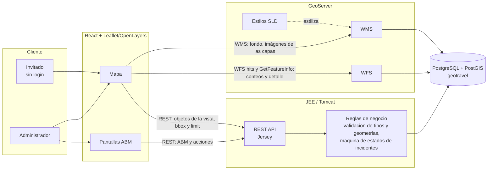
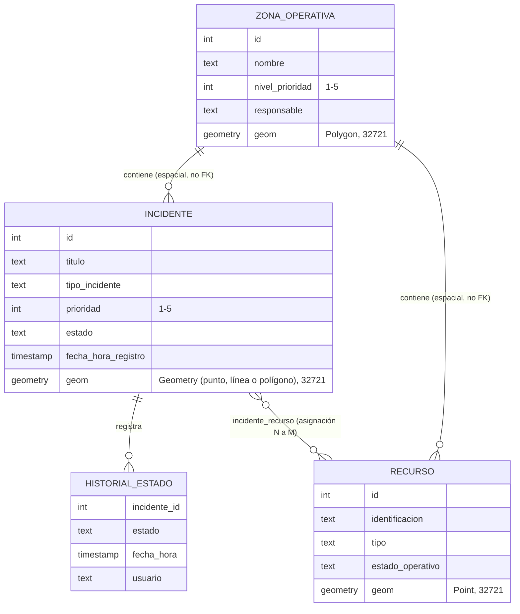
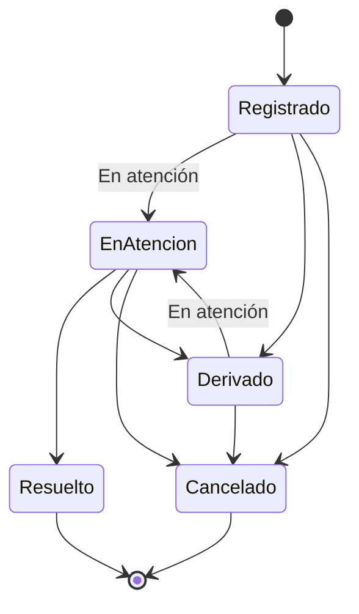

# Arquitectura

## Capas y quién las toca

| Capa | Tecnología | Módulo dueño |
|---|---|---|
| Datos | PostgreSQL + PostGIS (`db/migrations`) | P1 |
| Publicación de mapas | GeoServer (`geoserver/styles`) | P1 |
| API | JEE / Jersey (`backend/`) | P2 (base) + P3/P4/P5 (por módulo) |
| UI | React + Leaflet, y `leaflet.markercluster` para agrupar (`frontend/`) | P3/P4/P5 por módulo |

## Modelo de datos

`zona_operativa` no tiene relación de clave foránea con `incidente` ni con
`recurso` -- la pertenencia a una zona siempre se calcula espacialmente, no se
guarda: con `ST_Contains` para los recursos (son puntos) y con `ST_Intersects` para
los incidentes (pueden ser líneas o polígonos que cruzan el borde de una zona).
Es la misma decisión que en GeoTravel (zonas turísticas / recorridos).

`incidente.geom` es de tipo `Geometry`: un incidente puede ser un **punto** (un lugar),
una **línea** (una calle cortada) o un **polígono** (un área afectada).

## Máquina de estados de un incidente

**SUPUESTO a confirmar con el tutor:** la letra solo da un ejemplo lineal
("Registrado → En atención → Resuelto") y menciona que existen derivación y
cancelación, sin especificar desde qué estados se puede llegar a cada una.
Este diagrama es la interpretación usada en `IncidenteResource.java`
(constante `TRANSICIONES`) -- si el tutor confirma otra cosa, es el único
lugar del backend que hay que tocar.

## Carga a demanda: cómo se combinan GeoServer y el REST

El navegador nunca carga todos los objetos. Según el zoom:

| Zoom | Quién dibuja | Cómo llegan los datos |
|---|---|---|
| Lejos (menor que el mínimo: 13 en los ABM, 11 en Consultas) | **GeoServer**, como imágenes | WMS `GetMap`; el front no pide objetos |
| Cerca | **El front** (Leaflet), porque los objetos tienen que ser clickeables o editables | REST `GET /zonas?bbox=oeste,sur,este,norte&limit=500` → `{items, total, truncado}` |

- `bbox` en lon/lat (4326); el filtro usa el índice GiST (`geom && ST_MakeEnvelope(...)`).
- `limit` por defecto 500, máximo 2.000; `total` es la cantidad real (`count(*) OVER ()`) y `truncado` avisa si
  quedaron objetos afuera. En ese caso el front avisa "Mostrando 500 de N: acercá el mapa".
- Cuando el front dibuja un tipo de objeto, GeoServer deja de dibujar ese tipo (no se ve doble).
- Las zonas se simplifican 3 m al devolverlas: se dibujan igual y pesan mucho menos.
- Con cualquiera de los dos dibujando, los incidentes y recursos que quedan juntos se agrupan con un número hasta el zoom 14
  (GeoServer con `vec:PointStacker`; el front con `leaflet.markercluster`). Ver `docs/ICONOS.md`.
- Detalle: `docs/CARGA_POR_ZONA.md`.

## Por qué las consultas complejas van por REST y no solo por WFS

Las consultas geográficas (incidentes por zona, zonas con más incidentes,
recursos cercanos a un incidente, etc.) requieren joins entre
`zona_operativa`, `incidente`, `recurso` e `incidente_recurso` con
agregaciones — más flexible resolverlas como SQL directo en
`backend/.../consultas/ConsultaResource.java` que como `CQL_FILTER` de WFS.
Cada consulta devuelve ya la geometría de lo que encontró, para que el front la
dibuje sin pedir nada más. El mapa "de fondo" (capas completas, coloreadas por
SLD) sale directo de GeoServer vía WMS — no hace falta backend para eso.
