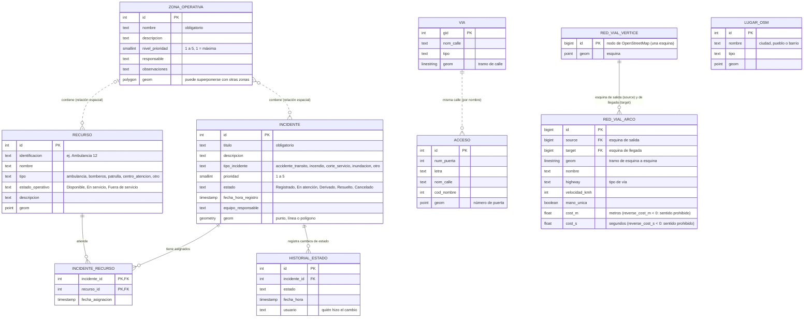

# Modelo entidad-relación (MER)

Sale de las migraciones de `db/migrations` (V1 a V4). Las geometrías están en SRID 32721 (UTM 21 Sur, metros).

## Cómo leerlo

- **Líneas continuas:** relaciones con clave foránea real.
  - Un incidente tiene muchos cambios de estado (`historial_estado`). Si se borra el incidente, se borra su historial.
  - `incidente_recurso` es la tabla intermedia de una relación N a M: un incidente puede tener varios recursos asignados y un recurso puede haber atendido varios incidentes. Guarda la fecha de asignación.
- **Líneas punteadas:** relaciones **espaciales**, que no tienen clave foránea. Se calculan con PostGIS al consultar.
  - Una zona contiene incidentes (`ST_Intersects`) y recursos (`ST_Contains`). Un incidente puede cruzar varias zonas o ninguna. Un recurso puede estar en más de una zona, porque las zonas pueden superponerse.
  - Las puertas se relacionan con las calles por el nombre y no por una clave.
- `VIA` y `ACCESO` son capas de referencia (calles y números de puerta de Salto). No se editan desde la aplicación.
- `RED_VIAL_VERTICE` y `RED_VIAL_ARCO` son la red por la que pgRouting calcula las rutas (OpenStreetMap de todo Uruguay, con sentidos y velocidades). La arma el servicio `red-vial`; tampoco se editan desde la aplicación. `LUGAR_OSM` son las ciudades, pueblos y barrios del mismo extracto, para decir en qué lugar queda un cruce de calles. Ver `docs/RED_VIAL.md`.

## Reglas y automatismos de la base

| Qué | Dónde | Detalle |
|---|---|---|
| Prioridad entre 1 y 5 | `zona_operativa`, `incidente` | `CHECK` |
| Estados válidos | `incidente.estado` | `CHECK` con los cinco estados de la letra |
| Estado operativo válido | `recurso.estado_operativo` | `CHECK` con tres valores |
| Primer registro del historial | `trg_incidente_historial_inicial` | Al crear un incidente, un trigger inserta su estado inicial en `historial_estado` |
| Zonas válidas | Backend (`ZonaResource`) | `ST_IsValid` y que sea un polígono (las zonas pueden superponerse; el trigger de V1 que lo impedía está comentado) |
| Búsqueda espacial rápida | Índices GiST en cada `geom` | Para cercanía y pertenencia a zonas |
| Puertas y calles | `idx_acceso_*`, `idx_via_*` | Búsqueda por nombre con trigramas |
